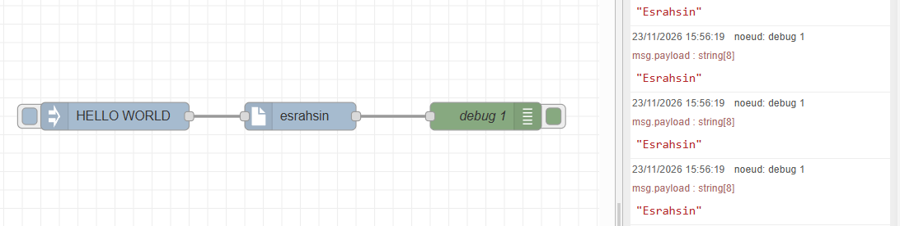

# node-red-contrib-esrahsin

## Overview

This is a custom Node-RED node created by Esrahsin.

This node receives a message as input and replaces the message payload with the string "Esrahsin".

Whatever the input message is, the node always returns "Esrahsin".

## How to Use

1. Open Node-RED.
2. Find the `esrahsin` node in the Function category.
3. Drag the node into your flow.
4. Connect an Inject node to the `esrahsin` node.
5. Connect the `esrahsin` node to a Debug node.
6. Click Deploy.
7. Click the Inject button.
8. Check the output in the Debug tab.

**Example Flow:**

`Inject → esrahsin → Debug`

**Expected Output:**

```text
Esrahsin
```

## Screenshot


## Sample Flow

The sample flow uses three nodes:

- Inject: Sends a message.
- esrahsin: Replaces the payload with "Esrahsin".
- Debug: Displays the output.

## Prerequisites

- Node.js
- Node-RED
- npm

## Change Log

### Version 1.0.0
- Created the custom Node-RED node.
- Changed the node name to esrahsin.
- Modified the JavaScript processing.
- Tested the node locally.